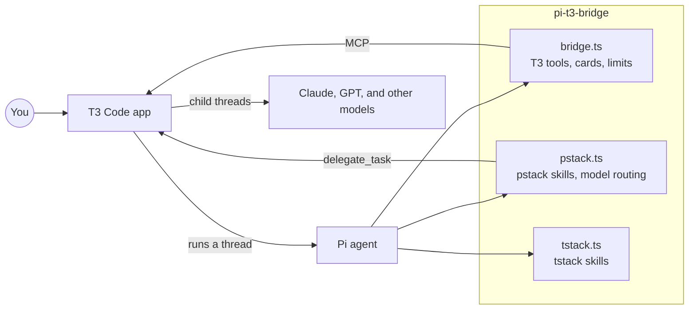
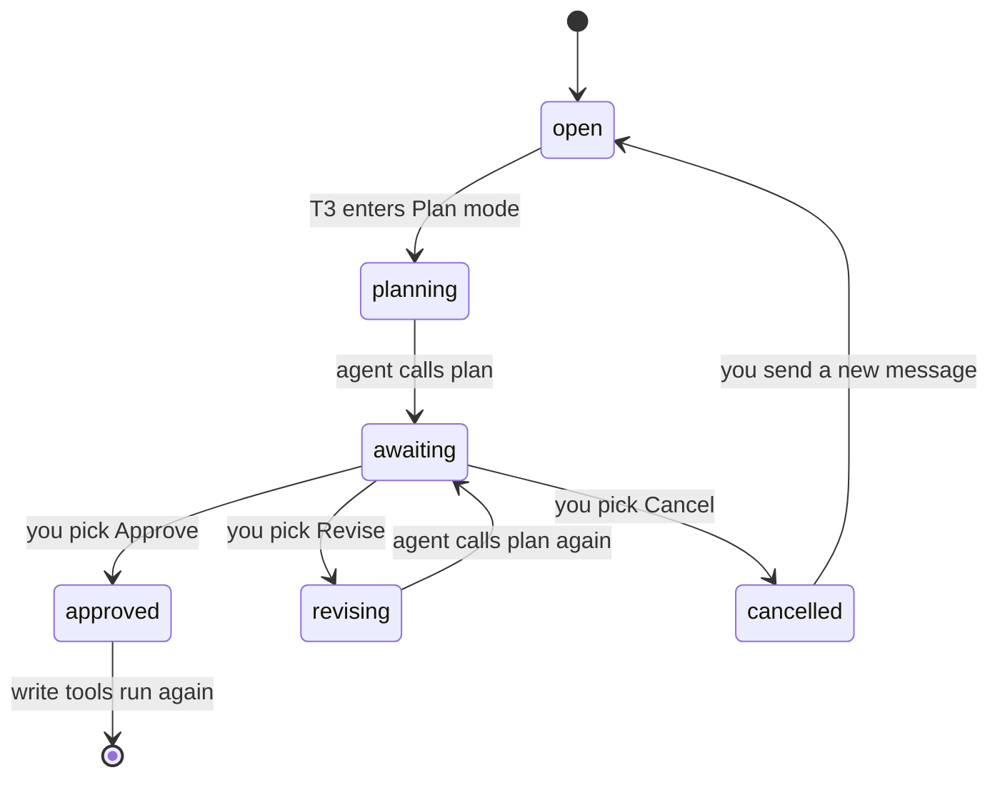
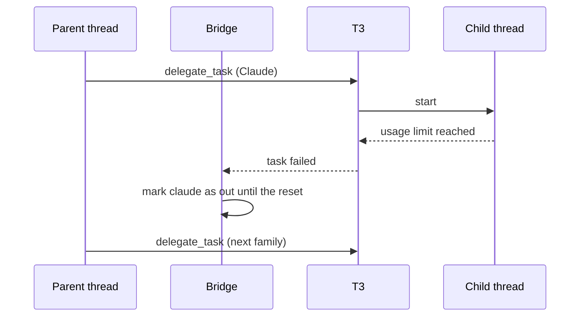
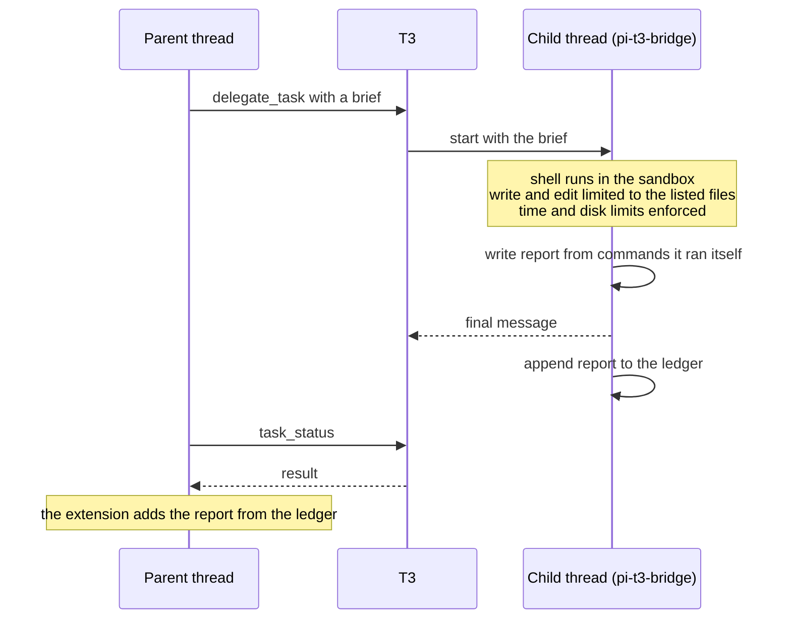

# pi-t3-bridge

pi-t3-bridge is a [Pi](https://pi.dev) package that lets Pi run as an agent inside [T3 Code](https://github.com/pingdotgg/t3code). It also ships two skill sets, pstack and tstack, so a Pi thread in T3 can plan work, hand parts of it to other models, and check what comes back.



## Requirements

You need the following programs:

- Node.js 22.19.0 or later
- Pi 1.4.0 or later
- T3 Code, if you want to run Pi threads inside T3 or call T3 tools from Pi
- On Linux, the `bubblewrap` package, for the sandbox that delegated children run in

The Ubuntu `bubblewrap` package ships an AppArmor profile that lets `bwrap` run, which we checked on Ubuntu 26.04. If AppArmor still stops `bwrap`, run `sudo sysctl -w kernel.apparmor_restrict_unprivileged_userns=0`.

## Install

The package is only on GitHub, not on npm. Install it with Pi:

```bash
pi install git:github.com/Snestra/pi-t3-bridge
```

Pi clones the repository, installs its dependencies, and loads every extension in the package on the next start. `pi update --extensions` moves the clone to the newest commit on `main`. To stay on a release instead, add its tag, e.g. `git:github.com/Snestra/pi-t3-bridge@v0.8.3`. To try the package for one session without saving it to your settings, run `pi -e git:github.com/Snestra/pi-t3-bridge`.

If you installed the old npm package, swap it for the git one:

```bash
pi remove npm:pi-t3-bridge
pi install git:github.com/Snestra/pi-t3-bridge
```

### Verify a release archive

You can install a signed archive instead of the git package. You need [Packslip](https://packslip.dev/docs/install/), the GitHub CLI, and `jq`. Run these commands in an empty directory:

```bash
version=0.9.1
tag="v$version"
archive="pi-t3-bridge-$version.tar.gz"
install_dir="$HOME/.local/share/pi-t3-bridge/$version"
gh release download "$tag" --repo Snestra/pi-t3-bridge --pattern "$archive" --pattern packslip.sigstore.json &&
packslip verify packslip.sigstore.json \
  --identity "https://github.com/Snestra/pi-t3-bridge/.github/workflows/packslip-release.yml@refs/tags/$tag" \
  --issuer https://token.actions.githubusercontent.com \
  --artifact "$archive" --json > packslip-verified.json &&
jq -e --arg version "$version" --arg archive "$archive" \
  '.project == "github.com/Snestra/pi-t3-bridge" and .version == $version and (.checked_artifacts | index($archive) != null)' \
  packslip-verified.json &&
mkdir -p "$(dirname "$install_dir")" &&
mkdir "$install_dir" &&
tar -xzf "$archive" -C "$install_dir" &&
(cd "$install_dir/pi-t3-bridge" && npm install --omit=dev --legacy-peer-deps --no-audit --no-fund) &&
pi install "$install_dir/pi-t3-bridge"
```

Packslip checks the archive, not the dependencies npm downloads. Pi does not update local packages. To update, verify and install the new archive, then remove the old local package with `pi remove`. Pi treats the new path as a separate package, so it does not show the old path's changelog updates.

## What is in the package

The package has three Pi extensions, and you can turn off any of them. No extension needs another one to be loaded, although `pstack.ts` reuses code from `src/bridge`.

```text
pi-t3-bridge/
├── bridge.ts       # connects Pi to T3 Code
├── pstack.ts       # serves pstack skills and picks models for subagents
├── tstack.ts       # serves tstack skills
├── src/
│   ├── bridge/     # code for bridge.ts
│   └── pstack/     # code for pstack.ts, including the child sandbox
├── pstack/         # upstream pstack skills, agents, and model defaults
├── overlay/        # the changes Pi needs on top of pstack/
└── tstack/         # Theo Browne's tstack skills
```

To load only some extensions, list the package in `~/.pi/agent/settings.json` in its object form:

```json
{
  "packages": [
    {
      "source": "git:github.com/Snestra/pi-t3-bridge",
      "extensions": ["bridge.ts"]
    }
  ]
}
```

## The bridge extension

The bridge gives Pi the tools and commands that T3 Code expects, and it shows them as cards in the T3 chat. If another installed package already has a tool with the same name, e.g. `ask` from pi-ask, the bridge keeps the other package's tool and tells you once that its own copy is off.

| Name | Kind | What it does |
| --- | --- | --- |
| `tasks` | tool | Shows the task list for the run as a card in the chat. |
| `plan` | tool | Shows a plan card with Approve, Revise, and Cancel buttons. |
| `ask` | tool | Asks you one or more questions as cards and waits for your answers. |
| `transcript` | tool | Returns the session file and session ID, for workflows that read the transcript. |
| `get_goal` | tool | Reads the saved goal, its revision, and its evidence. |
| `update_goal` | tool | Reports completion or a blocker for the current active goal. |
| `/goal` | command | Saves, inspects, edits, pauses, resumes, or clears one goal on the current session branch. |
| `/t3-usage` | command | Shows the cost of the thread and its children, the cache hit rate, and which model families are out of usage. |
| `/t3-transcript` | command | Records the transcript reference and shows the session file path. |
| `/t3-exhausted <family> [reset time]` | command | Marks a model family as out of usage for every chat on the machine. |
| `/t3-recovered <family>` | command | Marks a model family as usable again for every chat on the machine. |

### Saved goals

`/goal <objective>` saves one objective and starts work. The bridge requests another response when the agent stops before completing the objective. Goals have no token or time budget. Existing permissions still apply.

| Command | Result |
| --- | --- |
| `/goal` | Shows the objective, status, and reason without a model request. |
| `/goal <objective>` | Starts a new goal when no unfinished goal exists. |
| `/goal -- <objective>` | Starts a goal whose first word is `edit`, `pause`, `resume`, or `clear`. |
| `/goal edit <objective>` | Changes an unfinished goal and invalidates its old completion evidence. |
| `/goal pause` | Saves paused state before aborting goal work. |
| `/goal resume` | Activates a paused or blocked goal. Repeating the command does not start duplicate work. |
| `/goal clear` | Clears the goal and stops its work without deleting conversation history. |

In T3, use **Stop** during work, then send goal commands while the thread is idle. T3 rejects live goal commands before Pi receives them. Pi terminal and direct RPC sessions accept goal commands during work.

```text
active
  completion evidence       complete
  reported blocker          blocked
  Stop or restored session  paused
paused or blocked
  /goal resume              active
any state
  /goal clear               no goal
```

Goals live in `pi-t3-goal` session entries, not a machine-wide database. Each snapshot stores `version: 1` and either `goal: null` or an objective with its ID, revision, status, reason, and evidence. Loading, reloading, cloning, or navigating a session pauses a restored active goal. Compaction preserves the current state. Only an explicit resume command reactivates a paused goal.

Approval gates, unanswered questions, and pending children hold automatic continuation. A question dismissal or timeout needs a new user answer. A child wake or account recovery does not count as that answer. Goal-owned runs do not receive competing stop reminders, but MAST observations still run.

`update_goal` requires `goalId`, `revision`, `status`, `reason`, and `evidence`. The model can set only `complete` or `blocked` on an active goal. Completion requires evidence records with `requirement`, `source`, and `result`. A blocker requires a reason. The model is instructed to wait for three consecutive cycles with the same blocker. Runtime failures can stop work immediately.

The bridge rejects stale updates and incompatible goal tools. Account recovery records the failed run's goal identity and revision, so an old recovery cannot reactivate an edited, paused, completed, or cleared goal. Invalid saved goal data disables goal work until `/goal clear`.

Evidence records make completion inspectable. They do not prove that an arbitrary objective is complete. The feature assumes one Pi process owns the session file and does not promise exactly-once work across crashes. It does not add goal queues, automatic delegation, or model-created goals.

### Plan mode

When T3 is in Plan mode, or when a plan card waits for your answer, the bridge blocks every tool that can change files. Read-only tools still run, so the agent can keep reading files while you decide.



### Calls to T3 from a terminal

When you run Pi in a terminal instead of a T3 thread, the bridge connects Pi to T3's MCP server, which is the address where T3 Code serves its tools. You can then start threads, send messages to them, and wait on them from the terminal, and the status bar shows whether the connection works.

```text
on(session start)
  if Pi runs inside a T3 thread
    use the tools T3 already gives the thread
  else
    if the saved token is missing, rejected, or expires within a day
      sign in with the t3 CLI of the running server, no browser
      save the token in ~/.local/state/pi-t3/t3-mcp.json
    connect to http://127.0.0.1:3773/mcp with that token
    hide the tools that only work inside a T3 thread
    every 3 seconds, update the status bar
      "connected, N tools"
      "offline, start T3 Code"
      "sign-in failed: <reason>"
```

The bridge signs in on its own. The T3 CLI makes a one-time pairing code, and T3's sign-in endpoints take that code in place of a browser approval. The token lasts 30 days and has full access, the same as approving in the browser, because anyone who can run the CLI already owns the server. When `mcpUrl` points at a T3 server on another machine, the local CLI can't sign in there, so Pi falls back to `/mcp login t3`.

### Usage limits and resume

The bridge keeps one record of which model families are out of usage, and every Pi session on the machine reads it. When a child fails with a usage limit, the bridge marks the family as out until its reset time, so pstack sends new work to another family.



The main thread's own account can also run out, and then the agent can't call any tool. In that case the bridge asks T3 to post a resume message into the thread just after the reset time.

### Shell time limit

The bridge stops any shell command after 300 seconds, in the main thread and in children, so a test suite that hangs holds up the chat for at most 5 minutes. A command can ask for a shorter timeout but not a longer one. You can change the limit with `bashTimeoutSeconds` in the settings file.

### Stop checks

When a run is about to stop, the bridge asks a classifier model how the run ended, and it gives the agent one more turn if the agent gave up partway. The checks come from [pi-mast-steer](https://github.com/dbreunig/pi-mast-steer).

```text
on(run about to stop)
  ask the classifier how the run ended
  if the classifier is down or takes more than 5 seconds
    let the run stop
  if the agent gave up partway
    if a stop note was already sent for the current prompt
      log the check as capped in steer.jsonl and let the run stop
    add a note
    continue for one more turn

every 3 turns
  ask the classifier whether the agent shows a known failure
  if one is likely
    add a note that names it
```

The known failures come from MAST, a published list of the ways agent runs fail:

- The agent repeats a step that already finished.
- The agent doesn't know when to stop.
- The agent drifts away from the task.
- The agent breaks the brief, or says one thing and does another.

The bridge picks the classifier in the order below. It doesn't fall back to the next choice when the chosen classifier fails.

```text
pick classifier
  if classifierModel is set in the settings file
    use that chat model, or report an error if it's not in the catalog or has no auth
  else if typesafe/jev-latest is in your Pi model catalog and you have access
    use Jev
  else
    use the session model
```

A chat model answers the same questions through one tool call. Its probabilities are its own guesses, and the thresholds were fitted on Jev, so a chat model may add notes more often or less often than Jev. A chat model also costs tokens on your account, with one call for each stop check and one call every 3 turns. Set `steer` to `"shadow"` to log the verdicts without changing the session, or set it to `"off"` to turn the checks off.

## The pstack extension

The pstack extension adds the pstack skills to Pi's skill list, and it adds a note to each prompt that tells the agent when to enter `poteto-mode`. The `poteto-mode` skill picks the workflow that fits your goal, e.g. a bug fix, a feature, a design review, or a PR watch.

The skills come from [pstack](https://github.com/cursor/plugins/tree/main/pstack) by way of [t3-pstack](https://github.com/chhoumann/t3-pstack). The `pstack/` folder holds the upstream text unchanged, and `overlay/` holds the changes Pi needs.

```text
on(Pi start)
  copy pstack/ to ~/.local/state/pi-t3/pstack-overlay/<hash>/
  apply each change in overlay/ to the copy
  serve the skills from the copy
```

If a change in `overlay/` no longer matches the text in a new upstream version, the test run fails and names the file.

### Model routing

The `pstack_model` tool picks the model for each subagent. The agent passes a role, a job type, and a size, and the tool returns a target, which the agent passes to T3's `delegate_task`.

```text
pstack_model(role, job, size)
  if size is L
    refuse, so the agent splits the job
  if the model sheet names a model for the role
    use the model from the sheet
  else
    look up the job and size in the routing table
  if the model's family is out of usage
    use the same tier in the next family
    (GPT takes only size S work)
  return the target for delegate_task
```

The routing table lives in `pstack/models.json`. A size S job takes 30 minutes or less and touches 5 files or fewer, and a size M job takes 90 minutes or less and touches 15 files or fewer.

| Job | Size S | Size M |
| --- | --- | --- |
| `mechanical`, e.g. a lint fix or a rename | Haiku 5.5, low | Sonnet 5.5, medium |
| `check`, which runs given commands | GPT 6 Luna, low | Haiku 5.5, medium |
| `research`, which writes one notes file | Muse Spark 1.3, medium | Muse Wonder 1.0, medium |
| `implement`, one unit with named tests | GPT 6.1 Sol, medium | Sonnet 5.5, high |
| `hard`, e.g. concurrency or a bug with an unknown cause | Opus 5.5, high | Opus 5.5, high |
| `review` panel | Opus 5.5, Muse Wonder Full 1.0, and GPT 6.1 Sol, all high | same |
| `design` panel | Opus 5.5, Muse Wonder Full 1.0, and GPT 6 Astra, all high | same |

To choose your own models, run the `setup-pstack` skill, which writes a model sheet at `~/.config/pi-t3-bridge/models.md`. A line of `session hook: off` in the sheet stops the note about `poteto-mode` on each prompt.

### Limits for delegated children

When the first message of a session is a complete pstack brief, the extension treats the session as a delegated child and holds it to the limits in the brief. The child can't lift the limits through anything it writes.



The extension decides how to treat a session from its first message, in the order below.

```text
on(tool call)
  if the first message is not a "# Task:" brief
    run as your own session, with no limits
  else if the brief is complete
    run as a child, inside the sandbox and the limits
  else if T3 started the session as a delegated task
    block every tool, and list what the brief is missing
  else
    run as your own session, with no limits
```

A brief is complete when it has a header with the job, size, time limit, and disk limit, and all seven sections of the template in `pstack/skills/poteto-mode/brief.md`. A bullet under "Files you may write" may list several paths, and every word with a slash or a glob counts as a path. The disk limit leaves out `node_modules`, because pnpm fills it from the store, but build output still counts.

### The child sandbox

A delegated child runs every shell command in a sandbox, which is `sandbox-exec` on macOS and `bwrap` on Linux and WSL2. The sandbox lets the child write to its own work and to the caches that package managers need, and it keeps everything the parent runs later read-only.

```text
writable inside the sandbox
├── <workdir>/                       # the child's checkout
├── <git dir>/                       # objects and refs, so git commit works
│   ├── hooks/                       # read-only, the parent runs them later
│   └── config                       # read-only
├── ~/.cache, ~/.npm, ~/.local/share/uv, ~/.local/share/mise
├── ~/Library/Caches                 # macOS only
├── <pnpm store>/                    # the store `pnpm store path` names
├── <system temp folder>/            # also $TMPDIR and $XDG_RUNTIME_DIR
└── /dev
everything else is read-only
```

The bridge sets these variables for each child command:

| Variable | Value | Why |
| --- | --- | --- |
| `XDG_RUNTIME_DIR` | a new folder in the temp folder, one per child | pnpm 12 takes its store lock here, and the real one is read-only. |
| `TMPDIR` | the system temp folder | Commands such as `$TMPDIR/x` resolve to a writable folder. |
| `pnpm_config_store_dir` | the store `pnpm store path` names for the workdir | Under `bwrap`, pnpm can't hardlink across the sandbox's mounts, so without it pnpm builds a second store in the workdir. With it, pnpm copies from the shared store. |
| `npm_config_ignore_scripts`, `pnpm_config_ignore_scripts` | `true` | A root `prepare` such as `lefthook install` would fail on the read-only hooks, so install scripts don't run. |

Skipping install scripts has two side effects. First, a step that only a postinstall runs, e.g. `next typegen`, has to run through the build or typecheck that the brief names. Second, npm also skips the `pre` and `post` scripts of `npm run` and `npm test`, while pnpm still runs them.

On Linux the child also runs in its own process namespace, so it can see and signal only its own commands. A stray `pkill` from a child can't reach a daemon on the host, and anything a command starts in the background ends when that command ends.

Some programs need a change to run inside the sandbox:

- Chrome, Electron, and headless shells need `--no-sandbox`, because their own sandbox can't start inside `bwrap`. The child sandbox still confines them.
- A `pi` run inside a child needs `PI_CODING_AGENT_DIR` set to a writable temp copy of `~/.pi/agent`, because the real folder is read-only.

Native Windows and WSL1 have no sandbox. Where no sandbox can run, the bridge blocks a child's shell commands, unless you set `childSandbox` to `"off"` in the settings file.

## The tstack extension

The tstack extension serves Theo Browne's tstack skills from `tstack/skills`, which are babysit-pr, council, file-pr, full-send, full-stop, leaving-pr-comments, modernize, sol-loop, and takeover. It imports no other code from the package, so the skills stay available when you turn the other extensions off.

## Settings

The bridge reads one JSON file per machine, at `~/.config/pi-t3/config.json`. Every key is optional. The bridge reads the file again on each prompt, so an edit applies on the next prompt. If a value is invalid, only that key falls back to its default, and the bridge tells you once.

```json
{
  "bashTimeoutSeconds": 300,
  "childSandbox": "on",
  "classifierModel": "anthropic/claude-sonnet-4-5",
  "mcpUrl": "http://127.0.0.1:3773/mcp",
  "steer": "on"
}
```

| Key | Default | Meaning |
| --- | --- | --- |
| `bashTimeoutSeconds` | `300` | The longest a shell command can run, in seconds. |
| `childSandbox` | `"on"` | With `"on"`, a child's `bash` is blocked when no sandbox can run. With `"off"`, commands run with no sandbox on every platform, and the child's report says `SANDBOX: off`. |
| `classifierModel` | unset | The chat model that runs the stop checks, as `"provider/modelId"`. The model ID may contain more slashes. |
| `mcpUrl` | `http://127.0.0.1:3773/mcp` | The T3 MCP address to use from a terminal. |
| `steer` | `"on"` | The stop checks, as `"on"`, `"shadow"`, or `"off"`. |

The package writes its files in the places below. If `XDG_CONFIG_HOME` or `XDG_STATE_HOME` is set, the folder it names replaces `~/.config` or `~/.local/state`.

```text
~/.config/
├── pi-t3/config.json          # bridge settings
└── pi-t3-bridge/models.md     # model sheet, written by setup-pstack
~/.local/state/pi-t3/
├── accounts.json              # model families that are out of usage
├── ledger.jsonl               # one line per delegated brief, with cost and report
├── steer.jsonl                # one line per stop check verdict, with no transcript text
└── pstack-overlay/            # pstack skills with the Pi changes applied
```

Earlier releases kept the state and the model sheet under `t3-pstack`, and the first start after an upgrade moves them to the new folders.

## Data handling

The package has no server and sends no telemetry. The stop checks send parts of the session transcript to the classifier's provider, and any file a skill asks the agent to read goes to your model provider. Scripts run on your machine, and the PR tools use your GitHub CLI login.

## Development

The repository uses npm. The tests need Docker, because some of them run the child tests in Linux containers.

```bash
npm install
npm test           # node:test suites for the bridge and the pstack scripts
npm run typecheck
npm run check      # Ultracite lint and format check
```

The `pstack/` folder is a git subtree of t3-pstack. To take upstream changes, run `git merge -X subtree=pstack pstack-upstream`. Put Pi changes in `overlay/`, and leave `pstack/` as upstream wrote it.

## License

The package uses the MIT license. The copyright holders include the following people and companies:

- Lauren Tan, for the original pstack
- Cursor, for the imported cursor-team-kit and thermos skills
- Christian Bager Bach Houmann, for the T3 changes in t3-pstack

See [LICENSE](LICENSE) and [NOTICE.md](pstack/skills/poteto-mode/references/licenses/NOTICE.md) for the full list.
