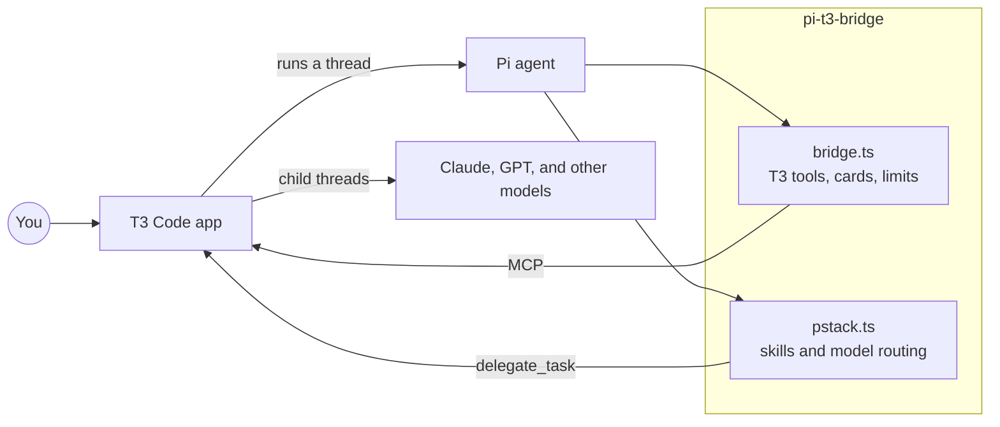
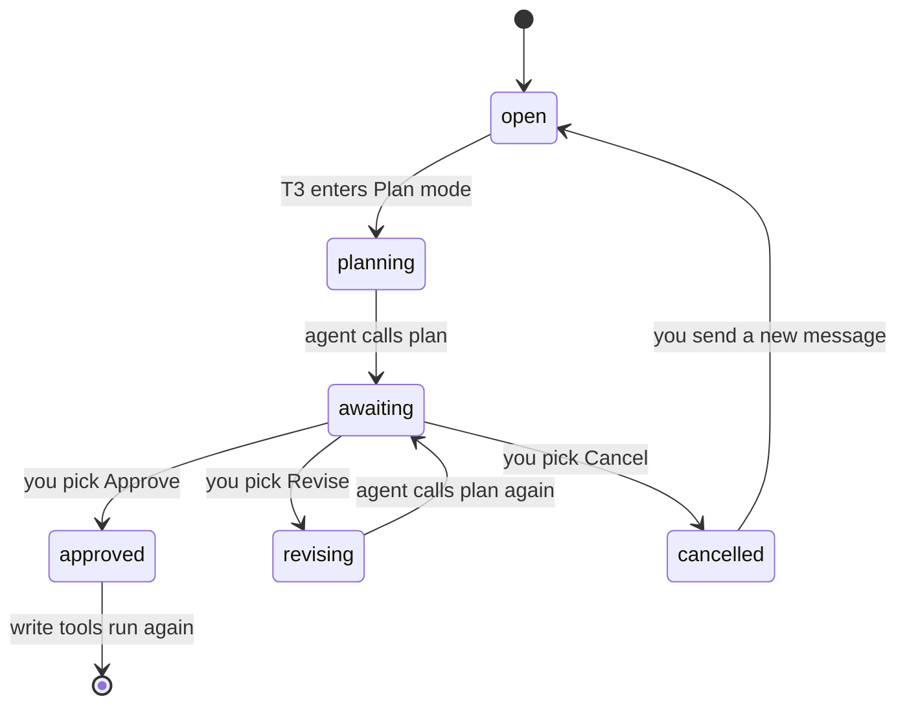
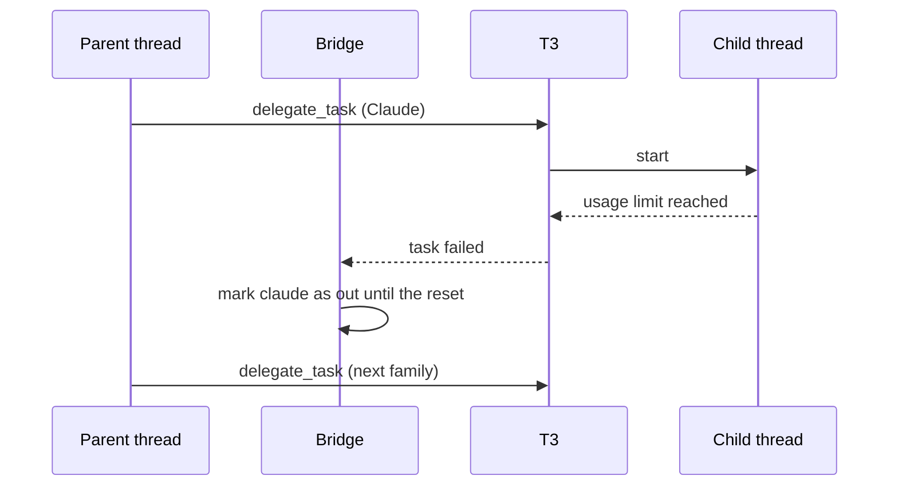
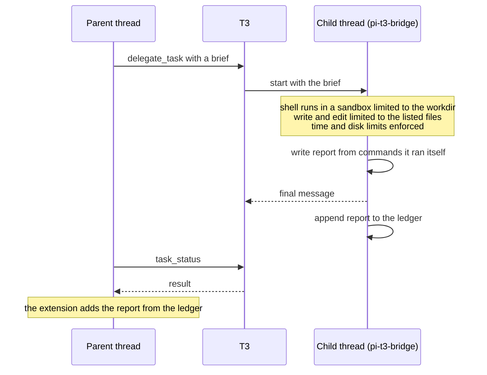

# pi-t3-bridge

pi-t3-bridge is a [Pi](https://pi.dev) package that lets Pi work as an agent inside [T3 Code](https://github.com/pingdotgg/t3code). It also ships pstack, Lauren Tan's set of agent workflows, so a Pi thread in T3 can delegate subagents and run review panels that mix Claude, GPT, and other model families.



## Requirements

You need the following programs:

- Node.js 22.19.0 or later
- Pi 1.4.0 or later
- T3 Code, if you want to run Pi threads inside T3 or call T3 tools from Pi

Delegated children run their shell commands in a sandbox: `sandbox-exec` on macOS, and `bwrap` (bubblewrap) on Linux and WSL2. Linux needs the `bubblewrap` package and unprivileged user namespaces. On Ubuntu, the `bubblewrap` package ships an AppArmor profile that lets `bwrap` run (checked on 26.04). If AppArmor still blocks it, run `sudo sysctl -w kernel.apparmor_restrict_unprivileged_userns=0`. Native Windows and WSL1 have no sandbox. Where no sandbox can run, a child's shell commands are blocked unless `childSandbox` is `"off"` in the config.

The tests need Docker, because they also run the child tests in Linux containers.

## Install

Install the package with Pi:

```bash
pi install npm:pi-t3-bridge
```

Pi loads both extensions in the package on the next start. To try the package for one session without saving it to your settings, run `pi -e npm:pi-t3-bridge`.

## What is in the package

The package has two Pi extensions, and you can turn off either one. The bridge in `bridge.ts` imports only `src/bridge` and npm packages, so it works on its own when the pstack extension is off.

```text
pi-t3-bridge/
├── bridge.ts         # extension 1: connects Pi to T3 Code
├── pstack.ts         # extension 2: adds pstack skills and model routing
├── src/
│   ├── bridge/       # code for bridge.ts
│   └── pstack/       # code for pstack.ts
└── pstack/           # upstream pstack skills, agents, and model defaults
    ├── skills/
    ├── agents/
    └── models.json
```

To load only the bridge, list the package in `~/.pi/agent/settings.json` in its object form:

```json
{
  "packages": [
    {
      "source": "npm:pi-t3-bridge",
      "extensions": ["bridge.ts"]
    }
  ]
}
```

## The bridge extension

The bridge gives Pi the tools and commands that T3 Code expects, and it shows them as cards in the T3 chat. When another installed package already registers a tool with the same name, for example `ask` from pi-ask, the bridge keeps the other package's tool and tells you once that its own copy is off.

| Name | Kind | What it does |
| --- | --- | --- |
| `tasks` | tool | Publishes the task list for the run as a card in the chat. |
| `plan` | tool | Shows a plan card with Approve, Revise, and Cancel buttons. |
| `ask` | tool | Asks you one or more questions as cards and waits for your answers. |
| `transcript` | tool | Returns the session file and session ID, for workflows that read the transcript. |
| `/t3-usage` | command | Shows the cost of the thread and its children, the cache hit rate, and which model families are out of usage. |
| `/t3-transcript` | command | Records the transcript reference and shows the session file path. |
| `/t3-exhausted <family> [reset time]` | command | Marks a model family as out of usage for every chat on the machine. |
| `/t3-recovered <family>` | command | Marks a model family as usable again for every chat on the machine. |

### Plan mode

When T3 is in Plan mode, or when a plan is waiting for your answer, the bridge blocks every tool that can change files. Only read-only tools run until you approve a plan.



### Calls to T3 from outside T3

When you run Pi in a terminal instead of inside a T3 thread, the bridge adds T3's MCP server, which is the endpoint that T3 Code serves its tools on. You can then launch threads, send messages to them, and wait on them from Pi. The status bar shows the connection state.

```text
on(session start)
  if Pi runs inside a T3 thread
    use the tools T3 already gives the thread
  else
    connect to http://127.0.0.1:3773/mcp
    hide the tools that only work inside a T3 thread
    every 3 seconds, update the status bar
      "connected, N tools"
      "offline, start T3 Code"
      "not signed in, run /mcp login t3"
```

### Usage limits and resume

The bridge keeps track of which model families are out of usage, and it shares that record with every Pi session on the machine. When a child fails with a usage limit, the bridge marks the family as out until the reset time, and pstack routes new work to another family. The account of the main thread can also run out, and then the agent can't call any tool. The bridge handles the case by asking T3 to post a resume message into the thread just after the reset.



### Shell timeout

The bridge caps every shell command at 300 seconds, in the main thread and in children. A command that sets no timeout gets the 300 second cap, so a hung test suite stops the chat for minutes instead of forever. Set `bashTimeoutSeconds` in the config to change the cap.

### Stop checks

When a run is about to stop, the bridge asks a classifier how the run ended. The classifier is `typesafe/jev-latest` from your Pi model catalog. When the classifier says the agent gave up partway, the bridge adds a note and gives the agent one more turn, at most twice per prompt. Every 3 turns during a run, the bridge also asks the classifier whether the agent shows a known failure, and it adds a note when one is likely. The failures it checks for come from the MAST list of agent failures:

- Stuck in a loop
- Doesn't know when to stop
- Wandered off
- Broke the brief, and says one thing but does another

```text
on(run about to stop)
  ask the classifier how the run ended
  if the classifier is down or takes more than 5 seconds
    let the run stop
  if the agent gave up partway and fewer than 2 notes were sent for this prompt
    add a note
    continue for one more turn
```

The stop check and the notes come from [pi-mast-steer](https://github.com/dbreunig/pi-mast-steer). Set `steer` to `"shadow"` in the config to log verdicts without changing the session, or to `"off"` to turn the checks off.

## The pstack extension

The pstack extension adds the pstack skills to Pi's skill catalog, and it adds a note to each prompt that tells the agent when to enter `poteto-mode`. `poteto-mode` picks the workflow that fits your goal, for example a bug fix, a feature, a design review, or a PR watch. The skills come from [pstack](https://github.com/cursor/plugins/tree/main/pstack) by way of [t3-pstack](https://github.com/chhoumann/t3-pstack), and they live unchanged under `pstack/`.

### Model routing

The `pstack_model` tool picks the model for each subagent. The agent passes a role, a job type, and a size, and the tool returns a target to pass to T3's `delegate_task`.

```text
pstack_model(role, job, size)
  if the model sheet names a model for the role
    use that model
  else
    look up the job and size in the routing table
  if that model's family is out of usage
    use the same tier in the next family
    (GPT takes only size S work)
  return the target for delegate_task
```

The routing table in `pstack/models.json` maps each job and size to a default model and reasoning level. Size S is a job of 30 minutes or less that touches 5 files or fewer, and size M is a job of 90 minutes or less that touches 15 files or fewer. The tool refuses size L, so the agent has to split the job.

| Job | Size S | Size M |
| --- | --- | --- |
| `mechanical`, such as a lint fix or rename | Haiku 5.5, low | Sonnet 5.5, medium |
| `check`, which runs given commands | GPT 6 Luna, low | Haiku 5.5, medium |
| `research`, which writes one notes file | Muse Spark 1.3, medium | Muse Wonder 1.0, medium |
| `implement`, one unit with named tests | GPT 6.1 Sol, medium | Sonnet 5.5, high |
| `hard`, such as concurrency or a bug with an unknown cause | Opus 5.5, high | Opus 5.5, high |
| `review` panel | Opus 5.5, Muse Wonder Full 1.0, and GPT 6.1 Sol, all high | same |
| `design` panel | Opus 5.5, Muse Wonder Full 1.0, and GPT 6 Astra, all high | same |

Run the `setup-pstack` skill to write your own model sheet at `~/.config/pi-t3-bridge/models.md`. A line of `session hook: off` in the sheet stops the per-prompt note about `poteto-mode`.

### Limits for delegated children

When the first message of a session is a complete pstack brief, the extension treats the session as a delegated child and holds it to the brief. The child can't lift the limits through anything it writes.



## Configuration

The bridge reads one JSON file per machine, at `~/.config/pi-t3/config.json`. Every key is optional. The bridge reads the file again on each prompt, so an edit applies on the next prompt. When one value is invalid, only the invalid key falls back to its default, and the bridge tells you once.

```json
{
  "bashTimeoutSeconds": 300,
  "childSandbox": "on",
  "mcpUrl": "http://127.0.0.1:3773/mcp",
  "steer": "on"
}
```

| Key | Default | Meaning |
| --- | --- | --- |
| `bashTimeoutSeconds` | `300` | The longest a shell command can run, in seconds. |
| `childSandbox` | `"on"` | Whether a delegated child's shell commands need a sandbox. With `"on"`, a child's `bash` is blocked when no sandbox can run. With `"off"`, commands run with no sandbox on every platform, and the child's report says `SANDBOX: off`. |
| `mcpUrl` | `http://127.0.0.1:3773/mcp` | The T3 MCP endpoint to use outside a T3 thread. |
| `steer` | `"on"` | The stop checks, as `"on"`, `"shadow"`, or `"off"`. |

The package writes its files in the following places. When `XDG_CONFIG_HOME` or `XDG_STATE_HOME` is set, those folders replace `~/.config` and `~/.local/state`.

```text
~/.config/
├── pi-t3/config.json          # bridge settings
└── pi-t3-bridge/models.md     # model sheet, written by setup-pstack
~/.local/state/pi-t3/
├── accounts.json              # model families that are out of usage
├── ledger.jsonl               # one line per delegated brief: cost and report
└── steer.jsonl                # one line per stop check verdict, with no transcript text
```

Earlier releases kept the state and the model sheet under `t3-pstack`. The first start after an upgrade moves them to the new folders once.

## Data handling

The package has no server and sends no telemetry. The stop checks send parts of the session transcript to the classifier provider in your Pi model catalog, and any file a skill asks the agent to read goes to your model provider. Scripts run on your machine, and the PR tools use your GitHub CLI login.

## Development

The repository uses npm, and the following commands check the code:

```bash
npm install
npm test           # node:test suites for the bridge and the pstack scripts
npm run typecheck
npm run check      # Ultracite lint and format check
```

The `pstack/` folder is a git subtree of t3-pstack. Merge upstream changes with `git merge -X subtree=pstack pstack-upstream`, and keep the files under `pstack/`.

## License

The package is under the MIT license. The copyright holders include the following people and companies:

- Lauren Tan, for the original pstack
- Cursor, for the imported cursor-team-kit and thermos skills
- Christian Bager Bach Houmann, for the T3 changes in t3-pstack

See [LICENSE](LICENSE) and [NOTICE.md](pstack/skills/poteto-mode/references/licenses/NOTICE.md) for the full list.
