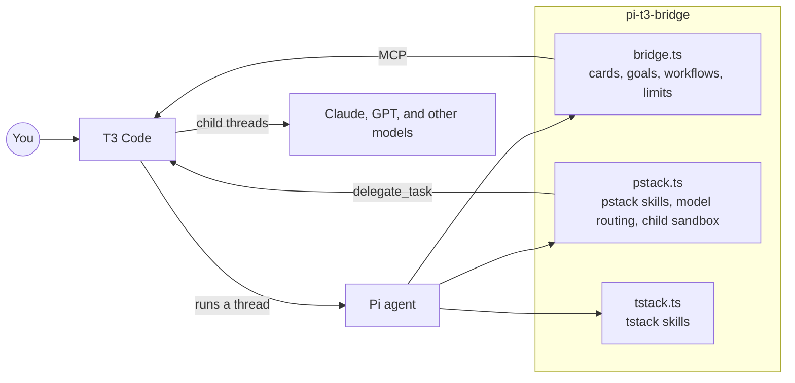
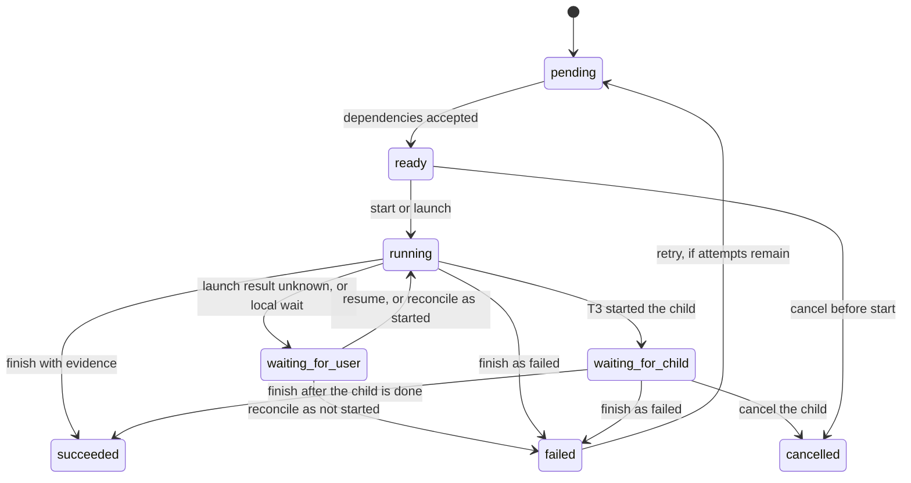
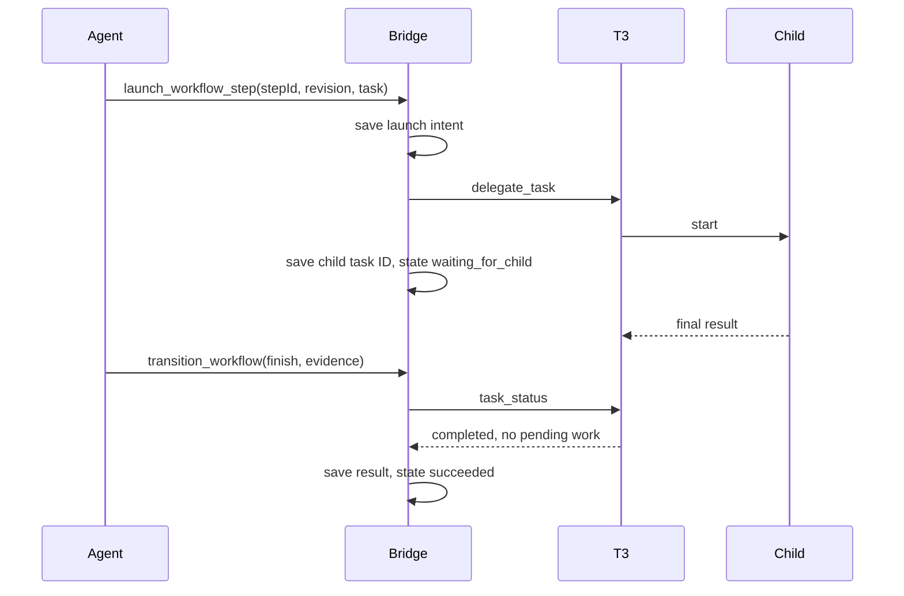
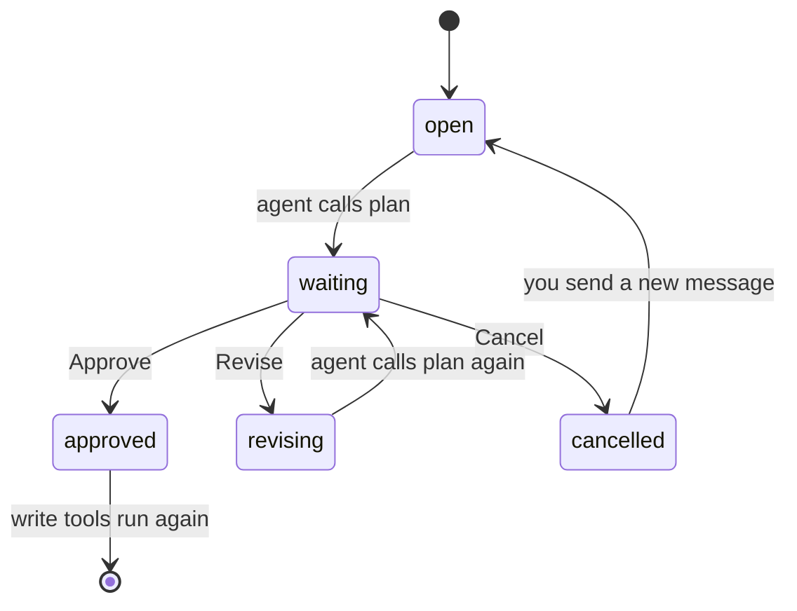
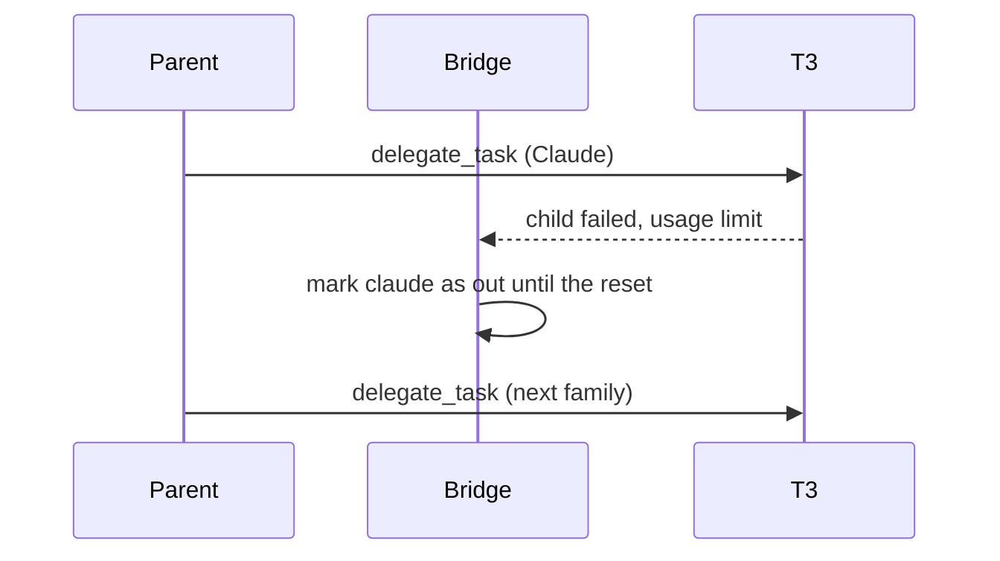

# pi-t3-bridge

pi-t3-bridge is a [Pi](https://pi.dev) package that runs Pi as an agent inside [T3 Code](https://github.com/pingdotgg/t3code). It gives a Pi thread the tools T3 expects, and it adds two skill sets, pstack and tstack, so the thread can plan work, hand parts of it to other models, and check what comes back.



## Requirements

You need Node.js 22.19.0 or later and Pi 1.5.0 or later. T3 Code is needed only if you run Pi threads inside T3 or call T3 tools from Pi.

On Linux, delegated children run in a `bwrap` sandbox, so you also need the `bubblewrap` package. If AppArmor stops `bwrap`, run `sudo sysctl -w kernel.apparmor_restrict_unprivileged_userns=0`.

## Install

The package is on GitHub only, so you install it with Pi from git.

```bash
pi install git:github.com/Snestra/pi-t3-bridge          # newest commit on main
pi install git:github.com/Snestra/pi-t3-bridge@v0.10.1  # one release
pi -e git:github.com/Snestra/pi-t3-bridge               # one session, nothing saved
```

`pi update --extensions` moves an install from `main` to the newest commit. If you still have the old npm package, run `pi remove npm:pi-t3-bridge` before you install from git.

Each of the three extensions works on its own, so you can load only the ones you want.

```json
{
  "packages": [
    {
      "source": "git:github.com/Snestra/pi-t3-bridge",
      "extensions": ["bridge.ts"]
    }
  ]
}
```

## What is in the package

```text
pi-t3-bridge/
├── bridge.ts       # connects Pi to T3 Code
├── pstack.ts       # serves pstack skills and picks models for subagents
├── tstack.ts       # serves tstack skills
├── src/bridge/     # code for bridge.ts
├── src/pstack/     # code for pstack.ts, including the child sandbox
├── pstack/         # upstream pstack skills, agents, and model defaults
├── overlay/        # the changes Pi needs on top of pstack/
└── tstack/         # Theo Browne's tstack skills
```

## Tools and commands

The bridge adds the tools and commands below, and T3 shows most of them as cards in the chat. If another package already has a tool with the same name, e.g. `ask` from pi-ask, the bridge keeps the other tool and tells you once.

| Name | What it does |
| --- | --- |
| `tasks` | Shows the task list for the run as a card. With `workflowId`, it shows a workflow's steps. |
| `plan` | Shows a plan card with Approve, Revise, and Cancel buttons. |
| `ask` | Asks you questions as cards and waits for your answers. |
| `create_workflow`, `get_workflow` | Save and read a workflow of steps with dependencies and acceptance checks. |
| `launch_workflow_step`, `reconcile_workflow_step` | Start a delegated step in T3, and settle a launch whose result is unknown. |
| `transition_workflow` | Starts, finishes, retries, or cancels a step, holds a local step for your decision, or records that a worktree step was merged. |
| `get_goal`, `update_goal` | Read the saved goal, and report completion or a blocker with evidence. |
| `transcript` | Returns the session file and session ID. |
| `pstack_model` | Picks the model for a subagent. It comes from `pstack.ts`. |
| `/goal` | Saves, shows, edits, pauses, resumes, or clears the session's goal. |
| `/t3-usage` | Shows the cost of the thread and its children, the cache hit rate, and which model families are out of usage. |
| `/t3-exhausted <family> [reset time]`, `/t3-recovered <family>` | Mark a model family as out of usage, or usable again, for every chat on the machine. |
| `/t3-transcript` | Shows the session file path. |

## Workflows

A workflow is a saved list of steps that the agent works through in order, and each step must show evidence before the steps after it can start. The agent creates one with `create_workflow` when a job has parts that depend on each other or that other models should do in parallel.

```text
create_workflow
  id: "fix-login"
  concurrency: 2        # steps that may run at the same time
  maxAttempts: 2        # tries per step
  goalId: <optional>    # ties the workflow to the saved goal
  steps:
    reproduce   local      shared    acceptance [repro-output]
    fix-api     delegated  worktree  depends on reproduce   acceptance [tests-pass]
    fix-ui      delegated  worktree  depends on reproduce   acceptance [screenshot]
    merge       local      shared    depends on fix-api, fix-ui   integrates fix-api, fix-ui
```

A step runs either in the parent thread or in a child thread. A local step always works in the parent's own checkout, which the schema calls `shared`. A delegated step runs in a T3 child, either in the same checkout or in its own git worktree.

| Executor | Isolation | How it starts | How it ends |
| --- | --- | --- | --- |
| `local` | `shared` | `transition_workflow` with `start` | `transition_workflow` with `finish` and evidence |
| `delegated` | `shared` or `worktree` | `launch_workflow_step`, which calls T3's `delegate_task` | `transition_workflow` with `finish`, after T3 reports the child done |

### Step states

A step becomes ready only when every step it depends on has succeeded with evidence for each acceptance ID. A worktree step's output must also be merged by a shared step that lists it in `integrates`, unless the step that depends on it is that same shared step.



### Launch and finish of a delegated step

The bridge records the intent to launch before it calls T3, so a crash between the two calls never leaves a child the workflow does not know about. After a restart, a step with only an intent moves to `waiting_for_user`, and the agent checks T3 and calls `reconcile_workflow_step`.



The bridge accepts a delegated step as finished only when T3 says the child is done, with no question, approval, or child work still pending. Otherwise `finish` saves the latest child status and leaves the step waiting.

### Rules the bridge enforces

The bridge checks every change against the saved workflow, so two calls can't overwrite each other and a stale plan can't run.

```text
on(any workflow change)
  if revision differs from the saved revision      refuse
  if the workflow belongs to another session or branch   refuse
  if the workflow names a goal that no longer allows work   refuse
  if a second shared step would write the checkout   refuse
  if running steps would exceed concurrency        refuse
  if the step has used all its attempts            refuse retry
  save the new workflow and add 1 to revision
```

Workflows live as `t3.workflow.v1` entries in the session file, so each branch of a session has its own workflows. When a workflow names the saved goal, the goal can't complete until every step of the workflow is accepted, and pausing the goal also cancels the workflow's running children.

## Saved goals

`/goal <objective>` saves one objective on the session branch and starts work on it. When the agent stops before it has finished, the bridge asks it to continue, until the agent reports completion with evidence or reports a blocker.

```text
active
  completion with current evidence   complete
  the same blocker for 3 cycles      blocked
  Stop, or a restored session        paused
paused or blocked
  /goal resume                       active
any state
  /goal clear                        no goal
```

| Command | Result |
| --- | --- |
| `/goal` | Shows the objective, status, and reason, without a model request. |
| `/goal <objective>` | Starts a goal when no unfinished goal exists. |
| `/goal -- <objective>` | Starts a goal whose first word is a command word, e.g. `edit`. |
| `/goal edit <objective>` | Changes an unfinished goal, and drops its old evidence. |
| `/goal approve` | Approves the acceptance conditions the agent proposed. |
| `/goal review` | Lets you judge evidence for conditions that no command can check. |
| `/goal pause`, `/goal resume`, `/goal clear` | Pause, restart, or remove the goal. |

The agent proposes acceptance conditions, and each condition may name a command and its exit code, or a file and the text it must contain. After you approve the conditions, the bridge runs those checks itself when the agent reports completion. A condition with no check waits for `/goal review`.

```text
update_goal(status: complete)
  if conditions are not approved            refuse
  if a question, approval, child, or linked workflow is pending   refuse
  if the files changed since the evidence   refuse, gather fresh evidence
  run each command and file check
  if every condition has current evidence   mark complete
```

In T3, press Stop before you send a goal command, because T3 refuses commands while the thread is busy. In a terminal or over RPC, you can send them at any time. With `pi -p "/goal <objective>"`, Pi waits for the goal's run to end before it exits.

Goals have no token or time budget, and normal permissions still apply. Opening, reloading, or cloning a session pauses an active goal, so only `/goal resume` starts work again.

## Plan approval

T3's own Plan mode does nothing in a Pi thread, because T3 doesn't send the Plan setting to Pi. The agent uses the `plan` tool instead, and while the plan card waits for you, the bridge blocks every tool that can change files.



Read-only tools still run while the card waits, so the agent can keep reading files. If the card can't render, the plan appears in a selection dialog instead.

## Reply checks

When a run is about to stop, the bridge checks the last reply with two fixed rules. No model judges the reply, so the same reply always gets the same result.

```text
on(run about to stop)
  if the reply hit the output limit
    continue, at most twice per prompt
  else if the last 5 lines of prose ask a question
      and the ask tool is on, and the session is not a child
    tell the agent to ask with the ask tool, once per prompt
```

A question in plain text ends the run, and nobody sees it. The second rule sends the agent back to put the question on an `ask` card, which waits for your answer. Code blocks and inline code don't count, so a `?` in a regex is ignored.

## Usage limits and resume

The bridge keeps one record of which model families are out of usage, and every Pi session on the machine reads it. When a child fails with a usage limit, the bridge marks its family as out until the reset time, and pstack sends new work to another family.



When the main thread's own account runs out, the agent can't call any tool. The bridge then asks T3 to post a resume message into the thread just after the reset time.

## Shell time limit

The bridge stops any shell command after 300 seconds, in the main thread and in children. A command can ask for a shorter limit but not a longer one, and you can change the limit with `bashTimeoutSeconds`.

## T3 tools from a terminal

When you run Pi in a terminal, the bridge connects it to the MCP server of the T3 Code app on your machine, so you can start and message T3 threads from the terminal.

```text
on(session start)
  if Pi runs inside a T3 thread
    use the tools T3 gives the thread
  else
    if the saved token is missing or expires within a day
      sign in with the t3 CLI, no browser needed
    connect to mcpUrl
    show "connected, N tools" or the error in the status bar
```

The token lasts 30 days and is saved in `~/.local/state/pi-t3/t3-mcp.json`. When `mcpUrl` points at a T3 server on another machine, sign in with `/mcp login t3` instead.

## The pstack extension

The pstack extension serves the [pstack](https://github.com/cursor/plugins/tree/main/pstack) skills, which reach Pi through [t3-pstack](https://github.com/chhoumann/t3-pstack). The `poteto-mode` skill picks the workflow that fits your request, e.g. a bug fix, a feature, a design review, or a PR watch.

```text
on(Pi start)
  copy pstack/ to ~/.local/state/pi-t3/pstack-overlay/<hash>/
  apply each change in overlay/ to the copy
  serve the skills from the copy
```

The `pstack/` folder keeps the upstream text unchanged, and `overlay/` holds the changes Pi needs. If an overlay change no longer matches a new upstream version, the tests fail and name the file.

### Model routing

The `pstack_model` tool returns the T3 target for a subagent, based on its role, job, and size.

```text
pstack_model(role, job, size)
  if size is L                      refuse, so the agent splits the job
  if the model sheet names a model  use it
  else                              look up job and size in pstack/models.json
  if the model's family is out      use the same tier in the next family
  return the target for delegate_task
```

| Job | Size S (30 min, 5 files) | Size M (90 min, 15 files) |
| --- | --- | --- |
| `mechanical` | Haiku 5.5, low | Sonnet 5.5, medium |
| `check` | GPT 6 Luna, low | Haiku 5.5, medium |
| `research` | Muse Spark 1.3, medium | Muse Wonder 1.0, medium |
| `implement` | GPT 6.1 Sol, medium | Sonnet 5.5, high |
| `hard` | Opus 5.5, high | Opus 5.5, high |
| `review` panel | Opus 5.5, Muse Wonder Full 1.0, GPT 6.1 Sol | same |
| `design` panel | Opus 5.5, Muse Wonder Full 1.0, GPT 6 Astra | same |

To choose your own models, run the `setup-pstack` skill. It writes a model sheet at `~/.config/pi-t3-bridge/models.md`, and a line of `session hook: off` in the sheet stops the `poteto-mode` note on each prompt.

### Limits for delegated children

When a session starts with a complete pstack brief, the extension treats it as a delegated child and holds it to the limits in the brief. The child can't lift the limits through anything it writes.

```text
on(tool call)
  if the first message is not a "# Task:" brief
    your own session, no limits
  else if the brief is complete
    child: sandboxed shell, writes only to listed files, time and disk limits
  else if T3 started the session as a delegated task
    block every tool and list what the brief is missing
  else
    your own session, no limits
```

A brief is complete when its header names the job, size, time limit, and disk limit, and it has all seven sections of `pstack/skills/poteto-mode/brief.md`. The child writes its report from commands it ran itself, and the parent reads the report from `ledger.jsonl` when it checks the task.

### The child sandbox

A delegated child runs every shell command in a sandbox, which is `sandbox-exec` on macOS and `bwrap` on Linux and WSL2. The child can write to its own work and to package manager caches, and everything else stays read-only.

```text
writable inside the sandbox
├── <workdir>/                    # the child's checkout
├── <git dir>/                    # so git commit works, except hooks/ and config
├── ~/.cache, ~/.npm, ~/.local/share/uv, ~/.local/share/mise
├── <pnpm store>/
├── <system temp folder>/         # also $TMPDIR and $XDG_RUNTIME_DIR
└── /dev
```

Install scripts don't run inside the sandbox, because a `prepare` such as `lefthook install` would fail on the read-only hooks. On Linux each child also gets its own process namespace, so a stray `pkill` can't reach the host.

Chrome and Electron need `--no-sandbox` inside the child, and a `pi` run inside a child needs `PI_CODING_AGENT_DIR` set to a writable copy of `~/.pi/agent`. Native Windows and WSL1 have no sandbox, so the bridge blocks a child's shell commands there unless you set `childSandbox` to `"off"`.

## The tstack extension

The tstack extension serves Theo Browne's skills from `tstack/skills`. They cover the PR cycle, from `file-pr` through `babysit-pr`, plus `council`, `sol-loop`, `full-send`, `full-stop`, `takeover`, `modernize`, and `leaving-pr-comments`.

## Settings and files

The bridge reads `~/.config/pi-t3/config.json` again on each prompt, and every key is optional. If a value is invalid, only that key falls back to its default.

| Key | Default | Meaning |
| --- | --- | --- |
| `bashTimeoutSeconds` | `300` | The longest a shell command can run, in seconds. |
| `childSandbox` | `"on"` | With `"off"`, child commands run with no sandbox on every platform. |
| `mcpUrl` | `http://127.0.0.1:3773/mcp` | The T3 MCP address for Pi in a terminal. It applies on the next `/new`, `/reload`, or start. |

```text
~/.config/
├── pi-t3/config.json          # bridge settings
└── pi-t3-bridge/models.md     # model sheet from setup-pstack
~/.local/state/pi-t3/
├── accounts.json              # model families that are out of usage
├── ledger.jsonl               # one line per delegated brief, with cost and report
├── t3-mcp.json                # T3 MCP token for Pi in a terminal
└── pstack-overlay/            # pstack skills with the Pi changes applied
```

`XDG_CONFIG_HOME` and `XDG_STATE_HOME` replace `~/.config` and `~/.local/state` when they are set.

## Data handling

The package has no server and sends no telemetry. Any file a skill asks the agent to read goes to your model provider, and the PR tools use your GitHub CLI login.

## Development

The repository uses npm, and some tests need Docker to run Linux containers.

```bash
npm install
npm test            # node:test suites for the bridge and the pstack scripts
npm run typecheck
npm run check       # Ultracite lint and format check
```

The `pstack/` folder is a git subtree of t3-pstack, so you take upstream changes with `git merge -X subtree=pstack pstack-upstream`. Put Pi changes in `overlay/`, and leave `pstack/` as upstream wrote it.

## License

The package uses the MIT license. See [LICENSE](LICENSE) and [NOTICE.md](pstack/skills/poteto-mode/references/licenses/NOTICE.md) for the copyright holders, who include Lauren Tan, Cursor, and Christian Bager Bach Houmann. The skills in `tstack/` keep their own MIT license from Theo Browne, in [tstack/LICENSE](tstack/LICENSE).
